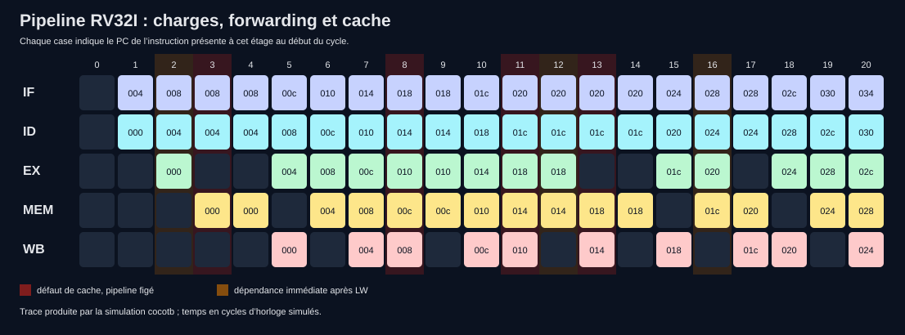

# Five-Stage RISC-V Processor (RV32I subset)

A **32-bit pipelined processor written in SystemVerilog**, verified with cocotb and an independent Python instruction-level model. This project follows an instruction from fetch through register writeback and exposes the real consequences of data dependencies, control-flow changes, and cache misses.

> **Status:** six simulation tests pass. This is a teaching/portfolio core implementing a documented RV32I **subset**, not a full ISA-compliant processor or a measured FPGA implementation.

```text
instruction memory ──► IF ──► ID ──► EX ──► MEM ──► WB
                         │      │      │       │       │
                         PC   decode   ALU    D-cache  registers
                              registers branch  data memory
                                  ╲      ▲
                                   forwarding + hazard control
```



The red columns are one-cycle data-cache misses; the amber columns show a load-use dependency. The cells contain instruction addresses (PC, hexadecimal), captured by cocotb from the RTL. See the [CSV trace](artifacts/pipeline_trace.csv) and [GTKWave VCD](artifacts/cache_demo.vcd).

## What is implemented

| Block | Function |
| --- | --- |
| IF / ID / EX / MEM / WB | Five registered pipeline stages; branch/jump decisions in EX; two younger instructions flushed on a taken redirect |
| Decoder and ALU | RV32I integer arithmetic/logic, shifts, comparisons, immediates, `LUI`, `AUIPC` |
| Register file | 32 × 32-bit registers, two read ports, one write port; `x0` stays zero |
| Hazard unit | EX/MEM and MEM/WB forwarding, WB-to-ID bypass, a load-use bubble, freeze on cache miss |
| Control flow | `BEQ`, `BNE`, `BLT`, `BGE`, `BLTU`, `BGEU`, `JAL`, `JALR` |
| Data path | Aligned `LW`/`SW`; separate 256-word instruction and data memories |
| Small data cache | Eight direct-mapped, one-word lines; write-through, no write allocation; a read miss adds one clock cycle |
| Observability | Pipeline stage PCs/valid bits, stall/redirect signals, cycle/retirement/stall/flush/miss counters |

Instruction encodings and the detailed pipeline behavior are in [docs/architecture.md](docs/architecture.md). The RTL is split into [ALU](rtl/rv32_alu.sv), [decoder](rtl/rv32_decode.sv), [register file](rtl/rv32_regfile.sv), [cache](rtl/rv32_dcache.sv), [core](rtl/rv32_core.sv), and [SoC/test wrapper](rtl/rv32_soc.sv).

## Reproduce the results (Windows + WSL2 Ubuntu)

From a WSL shell in this folder:

```bash
sudo apt update
sudo apt install -y python3-venv python3-pip build-essential iverilog verilator gtkwave
python3 -m venv .venv
.venv/bin/python -m pip install -r requirements.txt

# RTL static checks
verilator --lint-only -Wall --top-module rv32_soc rtl/rv32_*.sv

# Run all six architectural tests; good first check on any Ubuntu install
.venv/bin/python verification/run.py --sim icarus

# Because this folder's name has spaces, put the cocotb venv in a WSL
# path without spaces for Verilator's generated Makefiles.
python3 -m venv ~/rv32-venv
~/rv32-venv/bin/python -m pip install -r requirements.txt
~/rv32-venv/bin/python verification/run.py --sim verilator

# Generate a VCD waveform and inspect it with GTKWave
~/rv32-venv/bin/python verification/run.py --sim verilator --waves --test loads_stores_cache_and_load_use
gtkwave ~/.cache/rv32_verilator_sim/dump.vcd

# Or open the short waveform committed with the repository
gtkwave artifacts/cache_demo.vcd
```

When the project path contains a space, the runner copies the RTL and places Verilator's generated C++/Make build in `~/.cache/rv32_verilator_sim`; the cocotb virtual environment must also have a path without spaces. In a path without spaces, it uses `sim_build/verilator`. Pass `--verilator-bin /path/to/bin` if Verilator is installed outside `PATH`. **The results here were reproduced with Ubuntu's Verilator 5.032 and cocotb 2.1.0.** For another version, check the [official compatibility and installation documentation](https://docs.cocotb.org/en/stable/install.html) and [Verilator's build guide](https://verilator.org/guide/latest/install.html). An Icarus run is also provided for an independent simulator check.

The Python runner returns a nonzero exit code on a failed cocotb test. For a single test, add `--test sum_1_to_10_example` (or another test function name). Rebuild the example hex with `.venv/bin/python scripts/build_example.py`.

On GitHub, [the verification workflow](.github/workflows/verify.yml) repeats Verilator lint and the cocotb/Icarus architectural suite on each push or pull request, then uploads the XML report and trace as artifacts. The local Verilator command above runs the same tests with Verilator's VPI simulator.

## Verification and observed results

The [cocotb suite](verification/test_core.py) loads instruction words through a debug port, drives the clock, then compares **all 32 registers and all 256 data words** with an independent [sequential Python model](verification/model.py). Every supported-program test also checks retirement order and register state after each instruction. The sample [assembly program](examples/sum_1_to_10.s) stores and reloads the value **55**.

| Simulated workload | Retired instructions | Cycles | Stalls | Redirects | Cache misses |
| --- | ---: | ---: | ---: | ---: | ---: |
| Arithmetic and forwarding | 22 | 26 | 0 | 0 | 0 |
| Loads, stores, cache | 10 | 21 | 7 | 0 | 4 |
| Branches and jumps | 21 | 43 | 0 | 9 | 0 |
| Seeded mixed program | 82 | 105 | 19 | 0 | 17 |
| Sum 1 to 10 | 35 | 58 | 1 | 9 | 1 |

These are **cycle-accurate RTL simulation counters**, not measured clock frequency or hardware performance. The machine-readable results from [Verilator](artifacts/metrics_verilator.json) and [Icarus](artifacts/metrics_icarus.json) agree for these workloads and are regenerated by the suite. Test pass/fail details are in `sim_build/icarus/results.xml` or Verilator's build directory after each run. The separate illegal-instruction test checks the sticky fault signal.

For a fresh pipeline graphic, run `.venv/bin/python scripts/render_trace.py` after the full suite. The vector SVG is suitable for GitHub and presentations; the VCD gives cycle-by-cycle signal detail in GTKWave. See [docs/verification.md](docs/verification.md) for a reading guide and suggestions for deeper checks.

## Deliberate scope and next hardware steps

Only aligned word loads/stores are implemented. There are no byte/halfword accesses, system instructions, traps/interrupts, CSRs, multiplication/division, bus interface, or instruction cache. The memory arrays and debug preload ports make simulation self-contained. `debug_fault` reports unsupported instructions and misaligned accesses but does **not** implement architectural exception handling. There is no FPGA synthesis or board timing result yet; Yosys and a target-specific memory/bus wrapper are future work.

The design follows the [RISC-V unprivileged ISA](https://docs.riscv.org/reference/isa/unpriv/rv32.html), with simulation via [Verilator](https://verilator.org/guide/latest/) and [cocotb](https://docs.cocotb.org/en/stable/), and waveform inspection via [GTKWave](https://gtkwave.sourceforge.net/).
